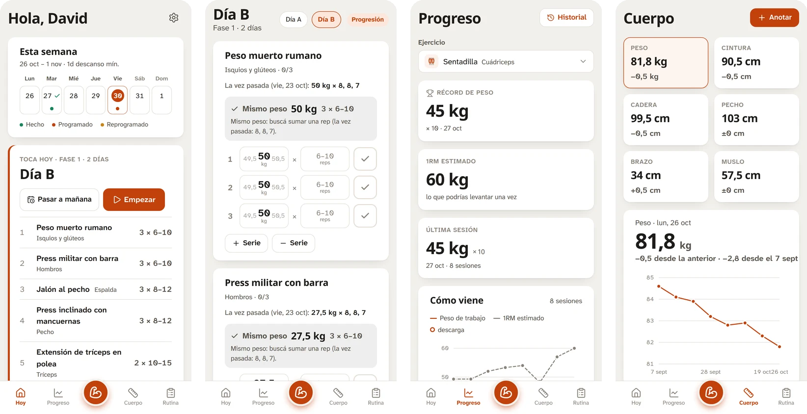
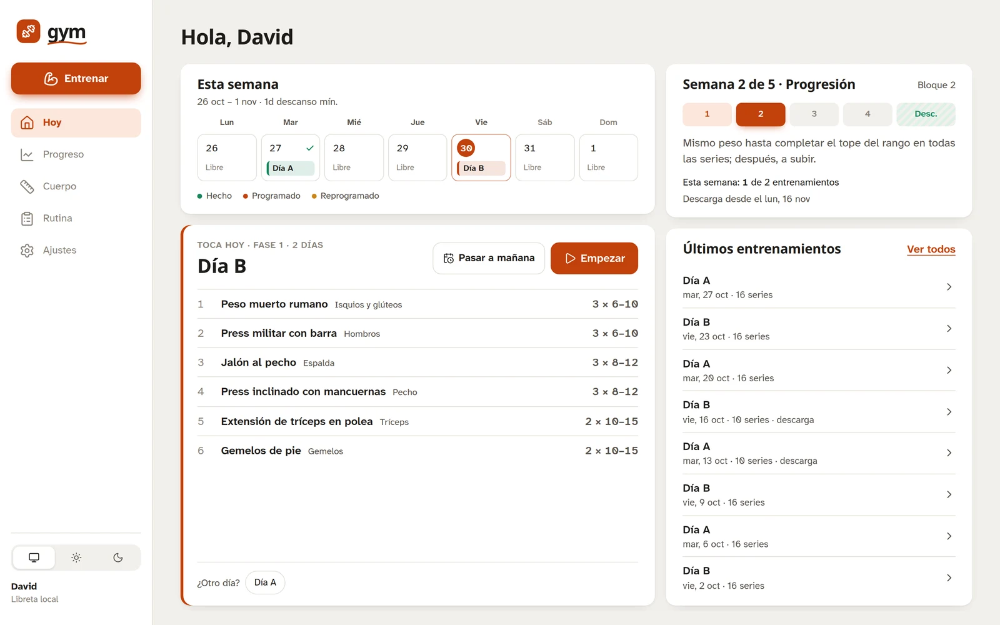
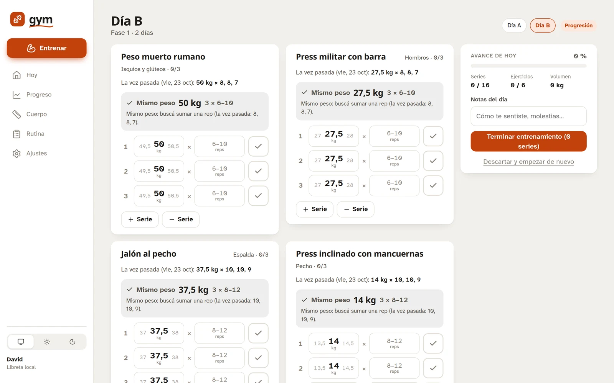
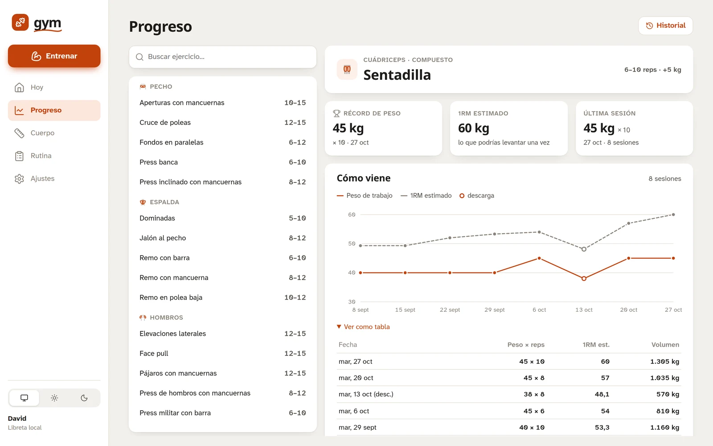
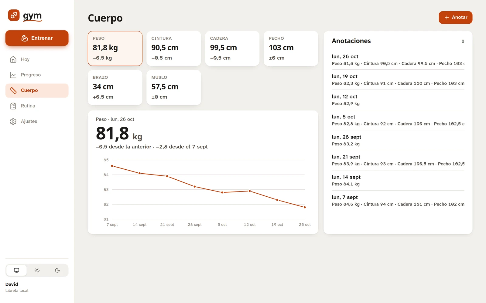
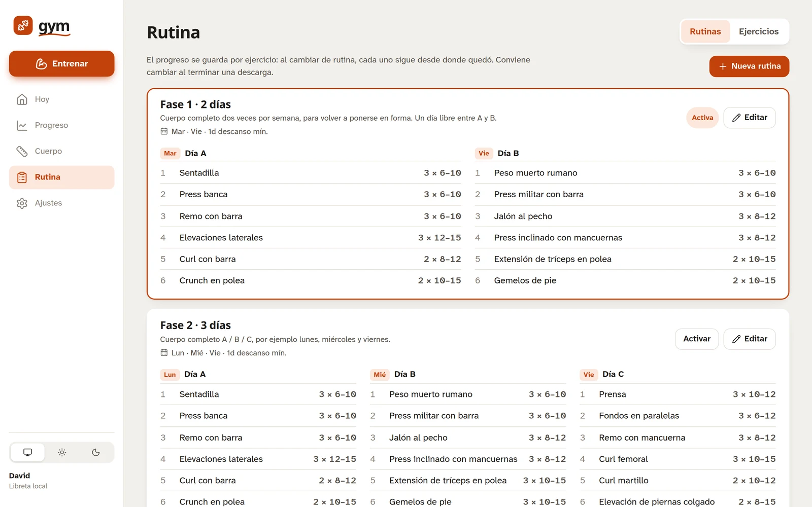

# Gym

> **Versión** 1.1.1 · **Última actualización** 2026-10-28 · [Desarrollo, deploy e historial de versiones](docs/DESARROLLO.md)

Libreta de gimnasio que te dice qué toca hoy, con cuánto peso arrancar cada ejercicio y cuándo descargar. La hice para volver a entrenar después de mucho tiempo con un plan que crece conmigo: dos días por semana al principio, después tres y en unos meses cuatro.

Hay dos versiones con las mismas pantallas: esta es la **web**, con backend propio y cuenta, que se instala como app desde el navegador; la **app Android**, sin servidor y con los datos en el teléfono, está en la rama [`mobile-nativo`](https://github.com/David-Schmidt02/app-gym/tree/mobile-nativo).

<picture>
  <source media="(prefers-color-scheme: dark)" srcset="docs/capturas/celular-oscuro.webp">
  
</picture>

<picture>
  <source media="(prefers-color-scheme: dark)" srcset="docs/capturas/escritorio-hoy-oscuro.webp">
  
</picture>

Las capturas usan datos inventados: ocho semanas de la rutina de 2 días. Siguen el tema claro u oscuro de GitHub, igual que la app sigue el del dispositivo. Las pantallas son las mismas en las dos versiones.

## Qué hace

- **Hoy**: en qué semana del ciclo estás (adaptación, progresión o descarga), la semana con lo hecho y lo programado, y el entrenamiento que toca, listo para empezar. Si un día no podés, «Pasar a mañana» corre lo que sigue respetando los días de descanso.
- **Entrenar**: cada ejercicio muestra lo que hiciste la vez pasada y la sugerencia de hoy con su motivo («Mismo peso: buscá sumar una rep»). Las series ya vienen con el peso; anotás las reps, marcás la serie y arranca el descanso. Si cerrás la app a mitad de camino, lo anotado sigue ahí.
- **Progreso**: por ejercicio, el récord de peso, el 1RM estimado y la curva de cada sesión, con las descargas marcadas. Desde ahí se corrige o se borra cualquier entrenamiento.
- **Cuerpo**: peso, cintura, cadera, pecho, brazo y muslo, con la diferencia contra la anotación anterior y contra la primera, y la curva.
- **Rutina**: tres rutinas de arranque (2, 3 y 4 días) que se editan a gusto, con el día de la semana de cada sesión, y un banco de ejercicios por grupo muscular con su rango de reps y cuántos kilos subir.
- **Ajustes**: semana del ciclo (para retomar, adelantar o repetir una descarga), tema claro u oscuro y la cuenta. Hay una sola: el registro se cierra al crearla.

<strong>Más pantallas</strong>

<picture>
  <source media="(prefers-color-scheme: dark)" srcset="docs/capturas/escritorio-entrenar-oscuro.webp">
  
</picture>

<picture>
  <source media="(prefers-color-scheme: dark)" srcset="docs/capturas/escritorio-progreso-oscuro.webp">
  
</picture>

<picture>
  <source media="(prefers-color-scheme: dark)" srcset="docs/capturas/escritorio-cuerpo-oscuro.webp">
  
</picture>

<picture>
  <source media="(prefers-color-scheme: dark)" srcset="docs/capturas/escritorio-rutina-oscuro.webp">
  
</picture>

## Cómo decide el peso

- **Doble progresión.** Cada ejercicio tiene un rango de reps (6–10 en los compuestos, 10–15 en los aislados). Mientras no llegues al tope en todas las series, mismo peso y una rep más; cuando llegás, sube el incremento del ejercicio (2,5 kg en torso, 5 kg en pierna) y volvés al piso del rango. Si dos sesiones seguidas con el mismo peso salen peor, baja un 10 % para volver a construir.
- **Ciclo con descarga.** Una semana de adaptación y después bloques de cinco: cuatro de progresión y una de descarga, con la mitad de las series y 15 % menos de peso. Las descargas no cuentan para la progresión.
- **Por ejercicio, no por rutina.** Al pasar de 2 a 3 o 4 días, cada ejercicio sigue desde donde quedó.

## Decisiones técnicas

- **Un solo servicio.** FastAPI sirve la API bajo `/api` y el build de React en el resto de las rutas: un deploy, un dominio y sin CORS.
- **SQLite en un volumen**, sin servidor de base de datos: para una persona alcanza y sobra. Las tablas se crean al iniciar.
- **Backend en capas:** routers delgados, servicios con las reglas de entrenamiento y excepciones de dominio que se traducen a HTTP en un solo lugar.
- **La lógica, con tests.** Progresión, ciclo, agenda y entrenamientos tienen su suite en pytest; el CI la corre en cada PR junto con el lint, el build del frontend y la imagen Docker.
- **Interfaz sin librería de componentes:** CSS propio con tokens para el tema claro y el oscuro, gráficos en SVG a mano e íconos por grupo muscular. Se instala como app en el teléfono.

## Dos versiones

| | `main` (esta rama) | [`mobile-nativo`](https://github.com/David-Schmidt02/app-gym/tree/mobile-nativo) |
|---|---|---|
| Dónde corre | Navegador, instalable como app | App Android (APK) |
| Datos | SQLite en el servidor, con cuenta | IndexedDB en el teléfono, sin cuenta |
| Stack | FastAPI + React en un contenedor | React + Capacitor, sin backend |

Las dos ramas están protegidas y tienen su propio CI.

## Stack

FastAPI, SQLAlchemy 2, Pydantic 2 y SQLite con `uv` en el backend; React 19 y Vite en el frontend; un solo contenedor pensado para Railway. Cómo levantarla en local, configurarla y desplegarla está en [docs/DESARROLLO.md](docs/DESARROLLO.md).

## Licencia

[MIT](LICENSE).
